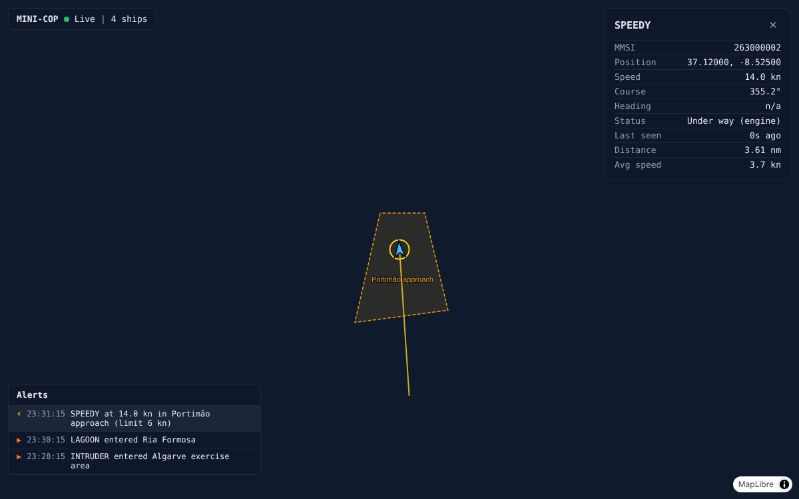

# atalaia — Mini-COP

A small **Common Operational Picture**: a live map of ships off the Portuguese
coast (mainland, Madeira and Azores), built from real AIS data, with route
history, zones and alerts.



## What it does
- **Live AIS ingestion** from aisstream.io over WebSocket.
  - Reconnects with backoff and jitter.
  - A watchdog reconnects after 2 minutes of silence.
- **Track state** for every ship.
  - Out-of-order reports are dropped.
  - Ships silent for 10 min are flagged stale and removed after 60 min.
- **Route history** per ship.
  - Haversine distance and average speed.
  - Filters GPS jitter and impossible jumps.
- **Zones and alerts.**
  - Entry and exit of restricted areas.
  - Speeding in speed-limited zones.
  - "Dark ship": a ship stops transmitting inside a zone.
- **Browser map** (React + MapLibre) that updates live: ships rotate with their course, stale ships fade, and clicking an alert flies to the ship.

## Architecture
```
aisstream ──► ingestion ──► asyncio.Queue ──► state task ──► TrackStore + AlertEngine
                               ▲                  │
                         clock Tick (30 s)        └──► Hub ──► WS /live ──► React + Zustand + MapLibre
                                                              GET /tracks, /tracks/{mmsi}/history,
                                                              /zones, /alerts, /area, /health
```
- **One process, event-driven, no broker.**
- **One task owns all state (single writer).** Positions and clock ticks share one queue, so no locks are needed.
- **The browser never talks to aisstream.** It gets a snapshot, then deltas, over a single WebSocket.

## Stack
- **Backend:** Python 3.11+, FastAPI, asyncio, Pydantic, websockets.
- **Frontend:** React 19, TypeScript, Zustand, MapLibre GL, Vite.
- **Tests:** pytest (81) and Vitest (12).

## Run it
You need an API key from https://aisstream.io.

```bash
cp .env.example .env        # set AISSTREAM_API_KEY; MINICOP_AREA=algarve or portugal

# backend (Python 3.11+)
cd backend
python3 -m venv .venv && source .venv/bin/activate
pip install -e ".[dev]"
uvicorn minicop.api:app     # http://localhost:8000
pytest

# frontend (Node 22.12+), in another terminal
cd frontend
npm install
npm run dev                 # http://localhost:5173
npm test
```

Areas are configured in `backend/config/areas.toml` and zones in
`backend/config/zones.toml`. Coordinates there are `[lat, lon]`, latitude first.

## Ideas for next steps
Not planned yet; candidates for a v2.

### Run it anywhere: Docker
- A `docker compose up` with two services: the backend (uvicorn), and the frontend built and served by nginx.
- nginx also proxies `/api` and `/live`, as Vite does in development.
- The API key is passed as an environment variable, never baked into the image.

### Persistence: a database
- **PostgreSQL + PostGIS** (or TimescaleDB) for positions, tracks and alerts.
- History survives restarts and is no longer capped at 2000 points per ship.
- Replay a past time window on the map ("what happened here last night?").
- Zone checks can move to SQL (`ST_Contains`) once there are many zones.

### Analytics without AI
- **Fishing hotspots.** Use a grid heatmap of positions from ships reporting status 7 ("fishing"), or moving slowly in a fishing pattern, aggregated by season and time of day.
  This is plain counting, with no model needed.
- **Traffic density and lanes.** The same kind of heatmap over all ships shows the shipping lanes.
- **Port calls.** Moored or anchored periods near ports give arrival and departure times and dwell times.

### Ideas using AI / ML
- **Route prediction.** Start with a baseline that extrapolates the current course and speed (dead reckoning).
  A model trained on past tracks could then predict where a ship will be in 30–60 minutes, and its likely destination.
- **Anomaly detection.** Flag behaviour that doesn't fit the ship's usual pattern:
  - loitering;
  - two ships meeting at sea (possible ship-to-ship transfer);
  - repeated "going dark" in the same place;
  - positions that jump in ways that suggest AIS spoofing.
- **Vessel type from movement.** Classify a ship from how it moves (fishing vs. cargo vs. leisure) when its declared type is missing or doesn't match.
- **Natural-language operator assistant.** An LLM over the live picture and the alerts could answer questions like "which ships went dark near Sagres today?" or write a shift summary.

## How it was built
In phases, each with a plan, tests and a write-up of the decisions in
[`docs/phases/`](docs/phases): data exploration, service, map, history,
resilience, zones and alerts.
